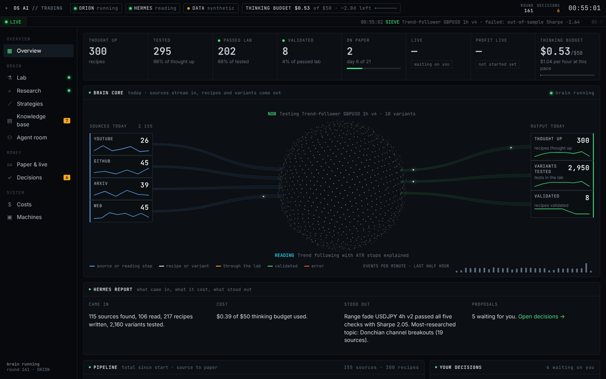
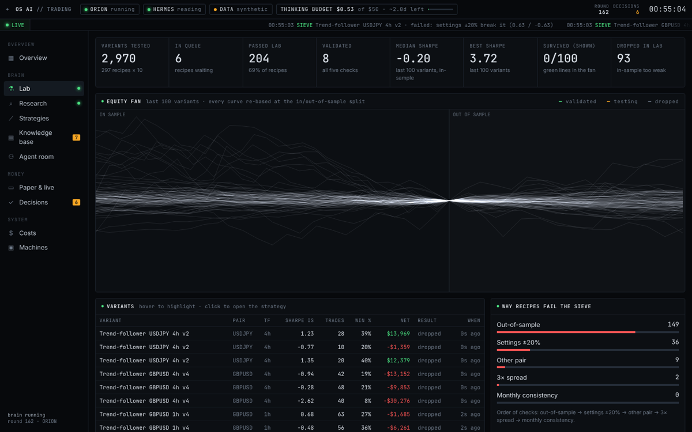
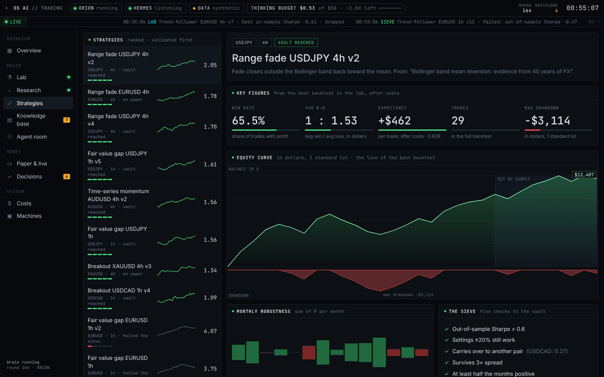
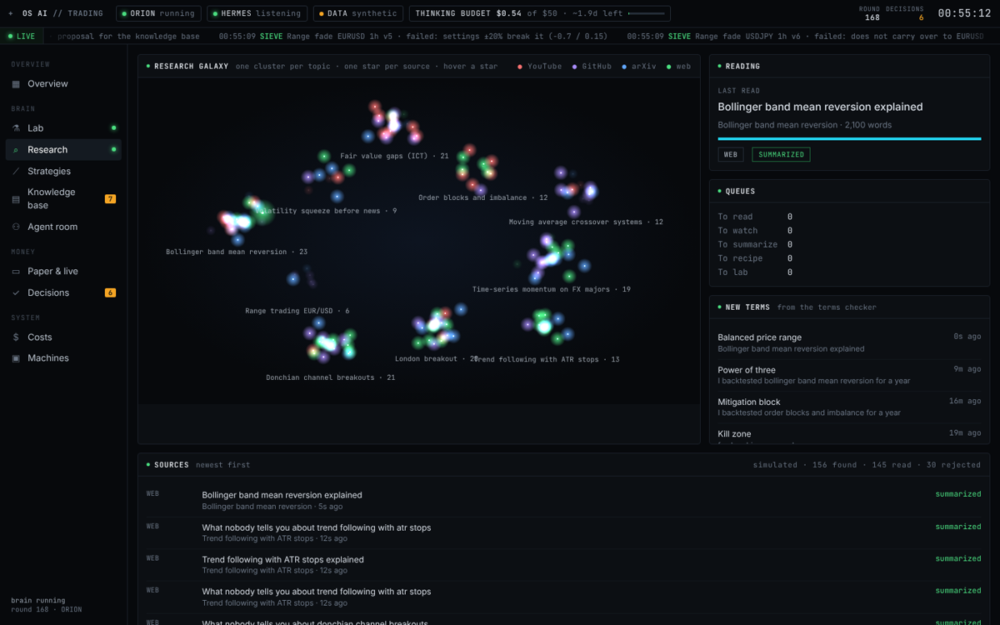
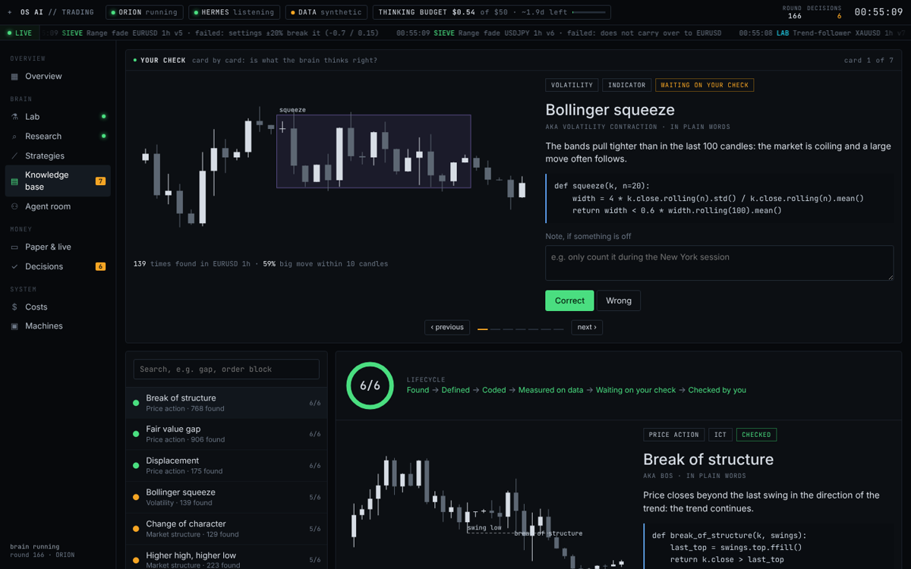
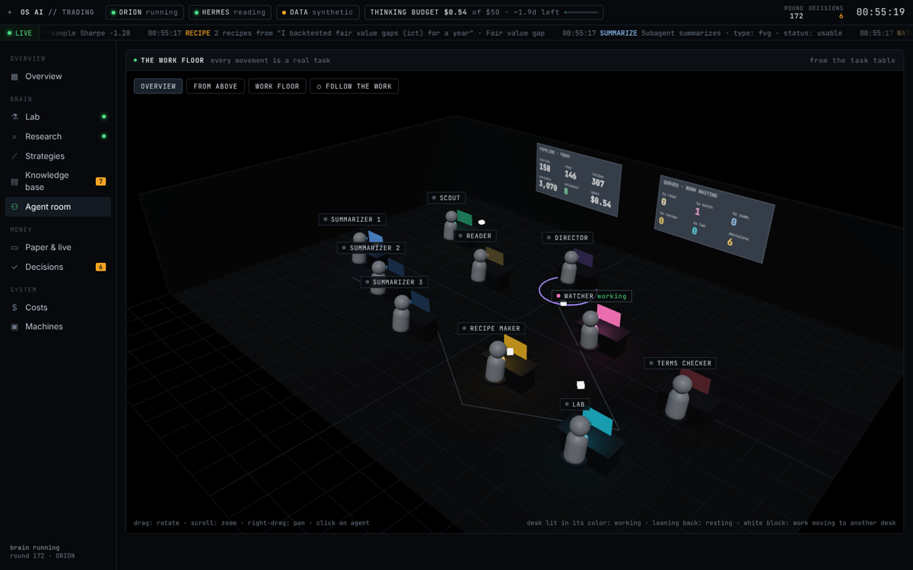
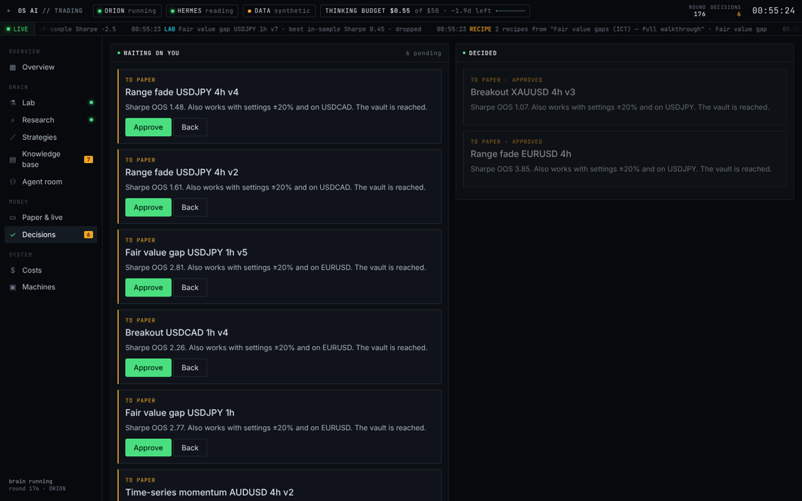

# OS Trading AI

An agentic forex research and trading system with a live dashboard. A team of agents finds
strategy ideas, turns them into testable recipes, backtests variants, filters them through a
robustness sieve, and paper-trades the ones **you** approve.



| | |
|---|---|
|  **Lab** — 10 variants per recipe, re-based at the in/out-of-sample split |  **Strategies** — key figures, equity, drawdown, the five-check sieve |
|  **Research** — one cluster per topic, one star per source |  **Knowledge base** — check each concept card by card |
|  **Agent room** — 3D work floor, every movement is a real task |  **Decisions** — nothing goes to paper or live without you |

*Screenshots from `npm run demo` (generated prices and research).*

```bash
npm install
cp .env.example .env   # optional: Anthropic key for Claude research, dashboard password
npm start              # http://localhost:3000
npm run demo    # fully simulated: generated prices and research, no keys needed
npm test
```

OS AI trades **meme coins** by default (Dogecoin, Shiba Inu, Pepe, Bonk, dogwifhat, Floki; set
`MARKETS` for others). Everything is real: prices come from **OS AI data** (real hourly prices
from Yahoo Finance's public feed, no key needed) and the agents research real
sources. If the feed cannot load, the server stops rather than inventing prices.

| Env var   | Default | Meaning                                                        |
|-----------|---------|----------------------------------------------------------------|
| `POLL_MS` | `30000` | How often to check the feed for newly closed candles |
| `ANTHROPIC_API_KEY` | — | Lets Claude analyze sources; without it a free keyword classifier is used |
| `ANALYST_MODEL` | `claude-opus-5-5` | Claude model for the summarizer agents |
| `ANALYST_EFFORT` | `low` | Claude effort level (`low` … `max`) |
| `GITHUB_TOKEN` | — | Optional; raises GitHub's search rate limit |
| `YOUTUBE_API_KEY` | — | Optional; adds YouTube (video titles and descriptions) as a source |
| `RESEARCH_SCOUT_MS` | `45000` | Pause between the scout's searches |
| `MARKETS` | meme coins | Markets to research and trade: by default DOGE, SHIB, PEPE, BONK, WIF and FLOKI. `all` adds forex, gold and bitcoin; or list symbols, e.g. `DOGEUSD,SHIBUSD,BTCUSD` |
| `DATA_SOURCE` | `osai` | `synthetic` for generated prices |
| `RESEARCH` | `live` | `simulated` for generated research |
| `BUDGET`  | `50`    | Thinking budget in USD (real Claude spend in live mode); research pauses at the limit |
| `DASHBOARD_PASSWORD` | — | Password for the dashboard when hosted publicly |
| `FRAME_ANCESTORS` | your Shopify domains | Sites allowed to embed the dashboard |
| `STATE_FILE` | `~/.os-ai/state.json` | Where strategies, paper trades, decisions and research are saved so restarts and redeploys keep them (not used by `npm run demo`) |
| `EXCHANGE`, `EXCHANGE_API_KEY`, `EXCHANGE_SECRET` | — | Connect a crypto exchange for live trading; see [docs/EXCHANGE.md](docs/EXCHANGE.md) for these and the `TRADE_USD`, `MAX_TRADE_USD`, `MAX_OPEN_TRADES`, `MAX_DAILY_LOSS` limits |
| `PORT`    | `3000`  | HTTP port |
| `TICK_MS` | `1500`  | One brain round every N ms |
| `WARMUP`, `DEMO` | on in `npm run demo` only | Pre-run rounds and auto-approval of the first two paper proposals |

## Host it and show it in your Shopify store

Shopify cannot run OS AI itself (it needs a server that stays on), so OS AI runs on a small
host and your store shows it on a page.

1. **Host:** OS AI runs on Hostinger at app.ostradingai.com; [docs/HOSTINGER.md](docs/HOSTINGER.md)
   covers updates, keys and the VPS installer. Any Node 18+ host also works with
   `npm ci && npm start`.
2. **Store page:** in Shopify admin, *Online Store → Pages → Add page*, switch the editor to
   HTML and paste `docs/shopify-page.html` with your host's address filled in. Keep the page
   hidden from the store menu.
3. The dashboard lives at **app.ostradingai.com** (a CNAME record `app` pointing at your host).
   The store page lives at `https://ostradingai.com/pages/os-ai`.

With `DASHBOARD_PASSWORD` set, every page and API call needs that password (any username).
`/healthz` stays open for the host's health check.

## Live research

- **Scout** searches arXiv, GitHub, Hacker News (web articles) and, with a key, YouTube, rotating
  through ten FX strategy topics. Already-seen URLs are skipped.
- **Reader / Watcher** fetch the full text: arXiv abstracts, repository READMEs, article bodies
  (HTML stripped) and video descriptions. Text beyond 40,000 characters is cut and marked.
  Sources that promise unrealistic returns ("never lose", "100% win rate") are rejected.
- **Summarizers** send each document to Claude (`claude-opus-5-5`, structured JSON output,
  server-side refusal fallback enabled). Claude decides whether the document describes a rule
  one of the six recipe templates can test, which pairs and timeframe it targets, and which
  settings it uses. The document is treated as untrusted data. Real token usage is priced and
  charged to the thinking budget, per agent, on the Costs page.
- **Recipe maker** tests the source's own settings on the pairs it names (or two others).
  Every recipe links back to its source.
- Failures (rate limits, unreachable sites) mark the agent *stuck* in red and appear in the log.

## OS AI data

Hourly candles for EUR/USD, GBP/USD, AUD/USD, USD/JPY, USD/CAD, gold (COMEX front-month
future), bitcoin (BTC/USD, 1 lot = 1 BTC) and six meme coins (DOGE, SHIB, PEPE, BONK, WIF, FLOKI)
from Yahoo Finance's public chart endpoint: about two years of history (the last 8,000 bars are
used) and new candles polled every `POLL_MS`. Crypto trades 24/7, so weekends count in its
backtests. The feed has no bid/ask, so backtests charge typical retail spreads (about 0.15% for
meme coins). It is unofficial and free, so Yahoo can change or rate-limit it.

**Keeping data current:** every hour the Lab's history takes in the newest candles, strategies
waiting for your approval are re-tested on them (a proposal that no longer passes is withdrawn
instead of waiting for you), and data nothing uses is dropped: failed recipes beyond the newest
200, decided decisions beyond the newest 100, and research links beyond the newest 3,000.

## How it works

```
Scout ──► Reader / Watcher ──► Summarizers (×3) ──► Recipe maker ──► Lab ──► Sieve ──► You ──► Paper ──► You ──► Live
  │                                  │                                                  ▲
  └── Terms checker ── knowledge base ┘                         Director: skill proposals, Hermes report
```

- **Agents** (`server/engine/brain.js`): Director, Scout, Reader, Watcher, three Summarizers,
  Terms checker, Recipe maker and Lab. Every action costs from the thinking budget and is logged.
- **Recipes** (`server/engine/strategies.js`): six templates — trend-follower (EMA cross),
  breakout (Donchian), range fade (Bollinger), time-series momentum, volatility squeeze and
  fair value gap — each with parameter ranges.
- **Lab** (`server/engine/backtest.js`): 10 variants per recipe on the first 70 % of the data,
  1 standard lot, spread charged per round trip, stop assumed before target on ambiguous bars.
- **The sieve**: out-of-sample Sharpe > 0.6 → settings ±20 % still work → carries over to another
  pair → survives 3× spread → at least half the months positive. Survivors are proposed to you.
- **Paper trading**: approved strategies trade bar-by-bar on the forward feed for 21 trading days;
  profitable ones are proposed for live.
- **Knowledge base** (`server/engine/patterns.js`): ICT / price-action concepts (BOS, FVG,
  displacement, CHoCH, order blocks, liquidity sweeps, …) with plain definitions, detector code
  and statistics measured on the data. You mark each one correct or wrong.

## Screens

Overview (KPIs, brain core, Hermes report, pipeline, logbook, decisions, equity fan) · Lab ·
Research galaxy · Strategies (key figures, equity + drawdown, monthly robustness, sieve) ·
Knowledge base (card-by-card check) · Agent room (3D work floor) · Paper & live · Decisions ·
Costs · Machines.

## Voice

Click the microphone in the top bar (Chrome, Edge or Safari), or press **V**, and speak. Press
**/** to type instead.

- **Commands:** "status", "go to the lab", "read decisions", "approve" (then "yes"), "kill switch",
  "announcements on", "change voice", "help".
- **Questions:** "what is gold at?", "which strategy is best?", "how are the paper trades doing?",
  "what is the account balance?" are answered from the live state. Any other question ("why do
  breakouts fail in ranges?") is answered by Claude when `ANTHROPIC_API_KEY` is set, and its cost
  comes out of the thinking budget.
- It uses the most natural English voice your device has; "change voice" switches.

Voice never arms real trading or approves a live strategy; do those on screen.

## DEX desk: Robinhood Chain on DexScreener

The **DEX · Robinhood** page scans [DexScreener's Robinhood Chain listings](https://dexscreener.com/robinhood)
every 10 minutes, reads prices every minute, builds 5-minute candles, filters out the obvious traps
(thin liquidity, brand-new pools, coins nobody is selling, inflated valuations, coins already up 60%
in an hour) and paper-trades the rest. Paper only: real on-chain swaps need a wallet; see
[docs/DEX.md](docs/DEX.md).

## Live trading on a crypto exchange

Strategies you approve to Live buy and sell real coins on your exchange account (Binance, Kraken,
Coinbase, Bybit, OKX and the other exchanges the [ccxt](https://github.com/ccxt/ccxt) library
supports). Spot only, so buys only: long signals buy, the close sells the same coins.
Every buy is capped, open trades are limited, stops and targets are checked on the exchange's
price every 30 seconds, a daily loss limit sells everything and disarms, and there is a kill
switch. Setup and limits: [docs/EXCHANGE.md](docs/EXCHANGE.md).

## What is still not real

- **Exchange trading** has been tested against a simulated exchange, not a real one yet; start
  with `EXCHANGE_SANDBOX=1` (the exchange's test network) before using real money.
- **Video research** reads titles and descriptions only; the YouTube Data API does not provide
  transcripts.

Nothing here is financial advice.

## License

Personal use only — see [LICENSE](LICENSE). No redistribution or resale.
